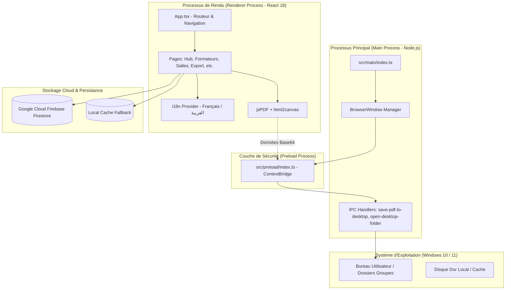

#  Système Intelligent de Gestion et de Planification des Emplois du Temps (OFPPT)
## نظام التدبير الذكي واستعمال الزمن لمؤسسات التكوين المهني

<div align="center">

[](https://github.com/LAMKADEMADIL/emploi-du-temps-ofppt)
[](https://github.com/LAMKADEMADIL/emploi-du-temps-ofppt)
[](https://www.electronjs.org/)
[](https://reactjs.org/)
[](https://www.typescriptlang.org/)
[](https://firebase.google.com/)
[](https://vitejs.dev/)
[](https://tailwindcss.com/)

<br/>


### **Royaume du Maroc — Office de la Formation Professionnelle et de la Promotion du Travail**
**Direction Régionale Casablanca - Settat | ISTA Tertiaire Moulay Rachid**

*Application bureautique moderne et autonome (Standalone Desktop) dédiée à la gestion intégrale, l'automatisation sans conflit et l'exportation haute fidélité des emplois du temps au sein des établissements de l'OFPPT.*

*تطبيق مكتبي متكامل مصمم خصيصاً لمؤسسات مكتب التكوين المهني وإنعاش الشغل، يتيح تنظيم جداول الحصص بدون أي تضارب زمني، مع إمكانية المزامنة السحابية والتصدير التلقائي بصيغة PDF و Excel مباشرة إلى سطح المكتب.*

---

[Fonctionnalités Clés](#-fonctionnalités-clés) •
[Architecture](#-architecture-technique) •
[Aperçu des Modules](#-modules-de-lapplication) •
[Installation & Lancement](#-installation-et-démarrage) •
[Génération & Build](#-build--packaging-windows) •
[Base de Données](#-base-de-données-cloud--offline) •
[Auteur](#-auteur--crédits)

---

</div>

<br/>

## 📖 Sommaire
- [🌟 Présentation Générale](#-présentation-générale)
- [✨ Fonctionnalités Clés](#-fonctionnalités-clés)
- [🖥️ Modules de l'Application](#️-modules-de-lapplication)
- [🏗️ Architecture Technique](#️-architecture-technique)
- [📂 Structure du Projet](#-structure-du-projet)
- [🚀 Installation et Démarrage Rapide](#-installation-et-démarrage-rapide)
- [📦 Packaging Windows (.EXE)](#-packaging-windows-exe)
- [🔌 Intégration Système IPC & Exports Directs](#-intégration-système-ipc--exports-directs)
- [🌐 Support Bilingue (Français / العربية)](#-support-bilingue-français---العربية)
- [🛡️ Sécurité et Sauvegarde](#️-sécurité-et-sauvegarde)
- [👨‍💻 Auteur & Crédits](#-auteur--crédits)

---

## 🌟 Présentation Générale

Dans les établissements de formation professionnelle (**OFPPT**), la gestion manuelle des emplois du temps est un défi majeur :
- Risques fréquents de double réservation de formateurs ou de salles.
- Difficulté à visualiser la disponibilité des espaces en temps réel.
- Perte de temps lors de la mise en page et de l'impression des plannings hebdomadaires.

**Gestion du Temps OFPPT** résout ces problématiques en fournissant un logiciel complet, rapide et intuitif avec une détection automatique des conflits, une synchronisation Cloud Firestore temps réel, et un système d'exportation automatisé vers le bureau Windows.

---

## ✨ Fonctionnalités Clés

* 🚫 **Zéro Conflit (Algorithme Intelligent) :** Contrôle instantané lors de l'attribution d'un créneau : vérification simultanée de la disponibilité du formateur, de la salle et du groupe.
* 👁️ **Visualisation Multi-Vues (Hub Centralisé) :**
  * **Vue Groupe :** Emploi du temps complet de la semaine pour chaque section.
  * **Vue Formateur :** Planning hebdomadaire par formateur avec calcul en temps réel de la masse horaire.
  * **Vue Salle :** Matrice d'occupation des salles de cours et des ateliers spécialisés.
  * **Détecteur de Salles Vides :** Recherche instantanée des locaux libres sur n'importe quel créneau.
* 📄 **Exportation Automatisée Haute Résolution :**
  * Génération PDF vectorielle au format officiel **A4 Paysage** avec en-tête institutionnel, logos et date.
  * **Classement automatique sur le Bureau Windows :** Création autonome d'un dossier par groupe sur le Bureau avec nommage propre des fichiers.
  * Export de classeurs **Excel (XLSX)** exploitables administrativement.
* ☁️ **Persistance Cloud & Mode Hors Ligne :**
  * Connexion **Google Firebase Firestore** pour synchroniser les données entre postes.
  * Mécanisme de fallback local pour continuer à travailler sans interruption même hors connexion.
* 🌍 **Interface Bilingue (Français / العربية) :** Basculement fluide entre le Français et l'Arabe avec adaptation directionnelle (RTL / LTR).
* 🔒 **Sécurité & Authentification :**
  * Système de connexion sécurisé pour l'administration.
  * Procédure complète de réinitialisation de mot de passe par code de vérification à 6 chiffres.

---

## 🖥️ Modules de l'Application

| Module | Description | Fichier Source |
| :--- | :--- | :--- |
| **🚀 Splash Screen** | Écran de démarrage animé avec branding institutionnel OFPPT et initialisation. | [`SplashScreen.tsx`](file:///src/renderer/src/pages/SplashScreen.tsx) |
| **🔐 Authentification** | Connexion sécurisée, gestion de session et réinitialisation de mot de passe. | [`LoginPage.tsx`](file:///src/renderer/src/pages/LoginPage.tsx) |
| **🗂️ Hub Central** | Tableau de bord principal, sélection des filières, groupes et basculement multi-vues. | [`HubPage.tsx`](file:///src/renderer/src/pages/HubPage.tsx) |
| **📅 Emploi du Temps** | Grille hebdomadaire interactive (Lundi au Samedi, 08h30 à 18h30) avec glisser/sélection. | [`TimetablePage.tsx`](file:///src/renderer/src/pages/TimetablePage.tsx) |
| **👨‍🏫 Formateurs** | Répertoire des formateurs, spécialités, contacts, quota horaire et import Excel. | [`FormateursPage.tsx`](file:///src/renderer/src/pages/FormateursPage.tsx) |
| **🏢 Salles & Ateliers** | Gestion des salles, capacités, typologies (cours, labo, atelier pratique). | [`SallesPage.tsx`](file:///src/renderer/src/pages/SallesPage.tsx) |
| **🔍 Planning Salles & Vides** | Matrice d'occupation en temps réel et détection des salles disponibles. | [`SalleGridPage.tsx`](file:///src/renderer/src/pages/SalleGridPage.tsx) |
| **🎓 Filières & Groupes** | Arborescence complète : Pôles, Filières (1ère & 2ème année) et Groupes. | [`FilieresPage.tsx`](file:///src/renderer/src/pages/FilieresPage.tsx), [`GroupesPage.tsx`](file:///src/renderer/src/pages/GroupesPage.tsx) |
| **💼 Stages Entreprise** | Planification et suivi des périodes de stage en milieu professionnel. | [`StagePage.tsx`](file:///src/renderer/src/pages/StagePage.tsx) |
| **📊 Structure & Affectations (DN / DNA)** | Définition des structures pédagogiques et des affectations modulaires. | [`DnPage.tsx`](file:///src/renderer/src/pages/DnPage.tsx), [`DnaPage.tsx`](file:///src/renderer/src/pages/DnaPage.tsx) |
| **🏖️ Vacances Scolaires** | Calendrier des jours fériés et des périodes de vacances institutionnelles. | [`VacancesPage.tsx`](file:///src/renderer/src/pages/VacancesPage.tsx) |
| **📤 Export PDF & Excel** | Moteur de rendu PDF vectoriel A4 et classement direct sur le Bureau. | [`ExportPage.tsx`](file:///src/renderer/src/pages/ExportPage.tsx) |
| **⚙️ Paramètres & Profil** | Personnalisation du nom de l'établissement, année scolaire et profil admin. | [`SettingsPage.tsx`](file:///src/renderer/src/pages/SettingsPage.tsx) |

---

## 🏗️ Architecture Technique

L'application suit le standard architectural **Electron + React + Vite** avec une séparation stricte des responsabilités via pont IPC sécurisé :



### 🛠️ Stack Technologique Détaillée

- **Runtime & Desktop :** [Electron 31](https://www.electronjs.org/), [Electron-Vite 2.3](https://electron-vite.org/)
- **Frontend :** [React 18](https://react.dev/), [TypeScript 5.4](https://www.typescriptlang.org/)
- **Bundler :** [Vite 5.3](https://vitejs.dev/)
- **Styles & UI :** [Tailwind CSS](https://tailwindcss.com/), [Lucide React](https://lucide.dev/) (Icônes vectorielles modernes)
- **Base de Données :** [Google Firebase Firestore 10](https://firebase.google.com/)
- **Documents & Tableurs :** [jsPDF 2.5](https://parall.ax/products/jspdf), [html2canvas 1.4](https://html2canvas.hertzen.com/), [SheetJS XLSX 0.18](https://sheetjs.com/)
- **Notifications :** [React Hot Toast](https://react-hot-toast.com/)
- **Packaging :** [Electron-Builder 26](https://www.electron.build/) avec installeur NSIS

---

## 📂 Structure du Projet

```text
emploi-du-temps-ofppt/
├── .github/                       # Configurations GitHub & Workflows
├── build/                         # Fichiers intermédiaires de compilation
├── installer/                     # Scripts et artéfacts d'installation NSIS
├── resources/                     # Ressources système et icônes
│   └── icons/
│       ├── icon.ico               # Icône Windows multi-résolutions (16x16 à 256x256)
│       ├── icon.png               # Icône PNG HD
│       └── icon.jpg               # Logo circulaire OFPPT
├── src/
│   ├── main/                      # PROCESSUS PRINCIPAL ELECTRON (Node.js)
│   │   └── index.ts               # Création fenêtres, IPC PDF desktop, raccourcis
│   ├── preload/                   # COUCHE D'ISOLATION ET CONTEXT BRIDGE
│   │   └── index.ts               # Expose electronAPI sécurisé au renderer
│   └── renderer/                  # PROCESSUS DE RENDU (REACT 18 + TS)
│       └── src/
│           ├── assets/            # Feuilles de styles et logos
│           │   ├── main.css       # Tailwind & styles globaux
│           │   ├── ofppt_logo.jpg
│           │   └── ofppt_logo_round.png
│           ├── components/        # Composants UI réutilisables
│           │   ├── GroupesVidesGrid.tsx
│           │   ├── SallesVidesGrid.tsx
│           │   └── Sidebar.tsx
│           ├── lib/               # Utilitaires, traductions et jeux de données
│           │   ├── i18n.tsx       # Gestion bilingue FR / AR
│           │   └── seedData.ts    # Initialisation des données de test
│           ├── pages/             # Modules et pages complètes de l'application
│           │   ├── Dashboard.tsx
│           │   ├── DnPage.tsx
│           │   ├── DnaPage.tsx
│           │   ├── ExportPage.tsx
│           │   ├── FilieresPage.tsx
│           │   ├── FormateursPage.tsx
│           │   ├── GroupesPage.tsx
│           │   ├── HubPage.tsx
│           │   ├── LoginPage.tsx
│           │   ├── SalleGridPage.tsx
│           │   ├── SallesPage.tsx
│           │   ├── SettingsPage.tsx
│           │   ├── SplashScreen.tsx
│           │   ├── StagePage.tsx
│           │   ├── TimetablePage.tsx
│           │   └── VacancesPage.tsx
│           ├── services/          # Services Cloud Firebase
│           │   └── firebaseService.ts
│           ├── types/             # Types et interfaces TypeScript
│           ├── App.tsx            # Composant racine et gestion des routes
│           └── main.tsx           # Point d'entrée React DOM
├── electron-builder.yml           # Configuration de packaging NSIS Windows
├── electron.vite.config.ts        # Configuration Electron-Vite
├── package.json                   # Dépendances et scripts npm
├── tsconfig.json                  # Configuration TypeScript
└── README.md                      # Documentation du projet
```

---

## 🚀 Installation et Démarrage Rapide

### Prérequis
* [Node.js](https://nodejs.org/) (Version **18.x** ou supérieure recommandée)
* Gestionnaire de paquets [npm](https://www.npmjs.com/) ou [yarn](https://yarnpkg.com/)
* Système d'exploitation : **Windows 10 / Windows 11**

### 1. Cloner le Dépôt
```bash
git clone https://github.com/LAMKADEMADIL/emploi-du-temps-ofppt.git
cd emploi-du-temps-ofppt
```

### 2. Installer les Dépendances
```bash
npm install
```

### 3. Lancer en Mode Développement
```bash
npm run dev
# ou
npm start
```
L'application démarre immédiatement avec rechargement à chaud (Hot Module Replacement - HMR).

---

## 📦 Packaging Windows (.EXE)

Pour compiler et générer l'installateur Windows autonome (`Setup.exe`) :

```bash
# Générer l'application empaquetée dans le dossier /release-app
npm run build:win

# Générer l'installateur complet Windows (NSIS Setup .exe)
npm run dist:win
```

L'exécutable généré sera disponible sous :
```text
release-app/Gestion_du_Temps_OFPPT_Setup_1.0.0.exe
```
L'installateur crée automatiquement un raccourci avec l'icône OFPPT sur le Bureau et dans le menu Démarrer de Windows.

---

## 🔌 Intégration Système IPC & Exports Directs

Contrairement à une simple application web bloquée par le bac à sable du navigateur, cette application Electron communique avec Windows via deux canaux IPC :

1. **`save-pdf-to-desktop`** :
   * Reçoit le flux binaire PDF Base64.
   * Nettoie les caractères interdits sous Windows (`\ / : * ? " < > |`).
   * Détecte le chemin dynamique du Bureau de l'utilisateur (`app.getPath('desktop')`).
   * Crée automatiquement un sous-dossier par Groupe (ex: `Desktop/DEV201/`).
   * Enregistre le fichier PDF en haute résolution sans boîte de dialogue bloquante.
2. **`open-desktop-folder`** :
   * Ouvre instantanément l'explorateur de fichiers Windows pointant directement sur le dossier du groupe généré.

---

## 🌐 Support Bilingue (Français / العربية)

L'application intègre un système d'internationalisation réactif permettant de basculer en un clic entre deux langues officielles :
* 🇫🇷 **Français :** Terminologie officielle OFPPT (Filières, Pôles, Modules, Formateurs, Stagiaires).
* 🇲🇦 **العربية :** واجهة عربية كاملة ومصممة بعناية مع دعم اتجاه النصوص وعناصر التحكم.

---

## 🛡️ Sécurité et Sauvegarde

* **Firebase Firestore :** Les collections sont partitionnées de manière hermétique (`users`, `timetables`, `formateurs`, `filieres`, `salles`, `settings`).
* **Offline Resilience :** En cas d'indisponibilité momentanée du réseau, le système de cache local prend le relais de manière transparente pour éviter toute perte de travail.
* **Récupération de compte :** Mécanisme de sécurité renforcé pour la récupération du mot de passe avec code d'autorisation unique.

---

## 👨‍💻 Auteur & Crédits

<div align="center">

Ce projet a été conçu et développé dans le cadre du projet de fin de formation par :

### **Adil Lamkadem**
*Filière Développement Digital / Génie Logiciel*  
**ISTA Tertiaire Moulay Rachid — OFPPT Casablanca**  
*Direction Régionale Casablanca - Settat*

[](https://github.com/LAMKADEMADIL)

---

**Copyright © 2026 ISTA Tertiaire Moulay Rachid — Tous droits réservés.**  
*Conçu avec fierté pour l'Office de la Formation Professionnelle et de la Promotion du Travail.*

</div>
